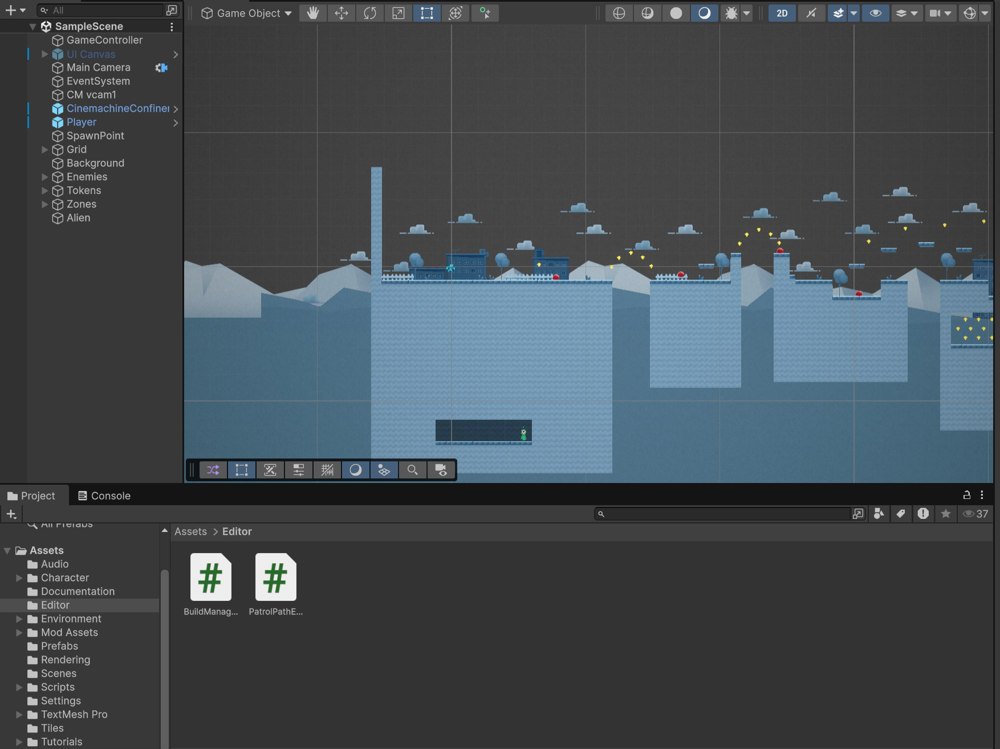
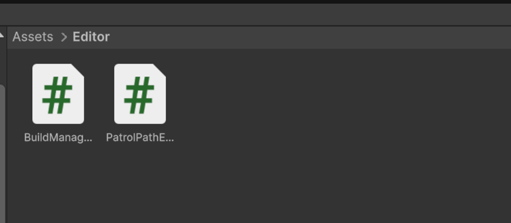
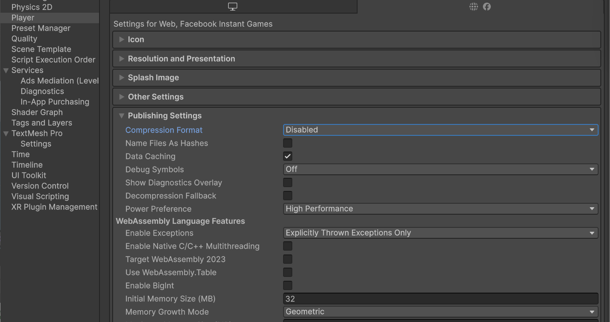
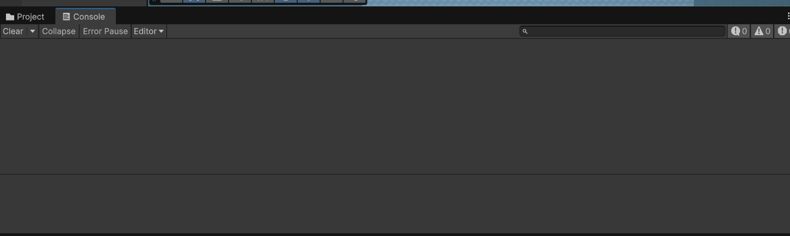
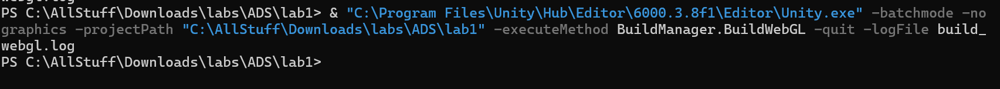
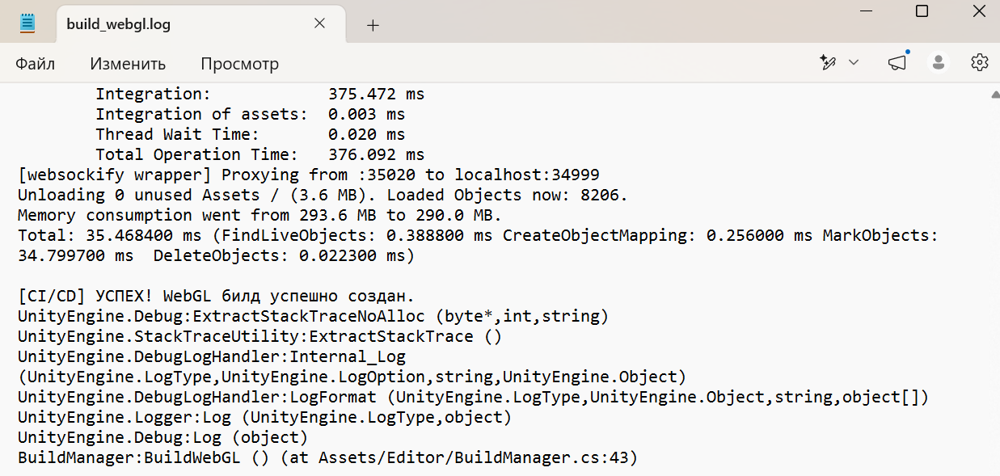
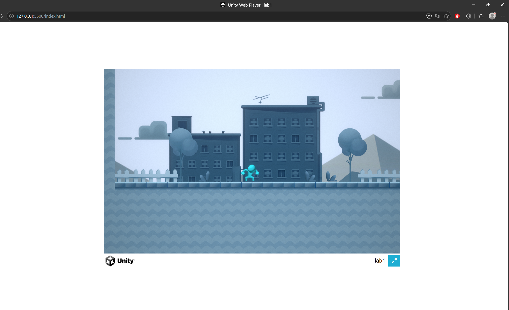
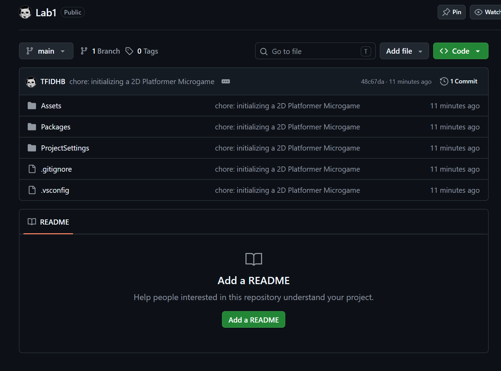

# Лабораторная работа №1. Сборка Unity WebGL-проекта через терминал

## Ход выполнения

### Шаг 1. Инициализация проекта


Рисунок 1 – Созданный проект в Unity Hub на базе шаблона 2D Platformer Microgame

Создан проект на базе шаблона 2D Platformer Microgame, проверена основная сцена в File -> Build Settings.

### Шаг 2. Скрипт BuildManager.cs


Рисунок 2 – Файл Assets/Editor/BuildManager.cs в окне Project

Создан скрипт Assets/Editor/BuildManager.cs, содержащий метод BuildManager.BuildWebGL(), который собирает проект под WebGL, проверяет наличие активных сцен и корректно завершает процесс Unity с кодом возврата.

### Шаг 3. Отключение сжатия для WebGL


Рисунок 3 – Project Settings -> Player -> Publishing Settings, Compression Format = Disabled

В настройках Player для WebGL параметр Compression Format изменён с Gzip на Disabled – это необходимо, чтобы локальный веб-сервер (Live Server) мог корректно отдавать несжатые файлы билда.

### Шаг 4. Проверка скрипта


Рисунок 4 – Отсутствие ошибок компиляции в консоли Unity

Скрипт скомпилирован без ошибок.

### Шаг 5. Локальная сборка через терминал


Рисунок 5 – Терминал с выполненной командой сборки

Выполнена команда:

```powershell
& "C:\Program Files\Unity\Hub\Editor\<версия>\Editor\Unity.exe" -batchmode -nographics -executeMethod BuildManager.BuildWebGL -quit -logFile build_webgl.log
```

### Шаг 6. Анализ логов сборки


Рисунок 6 – Содержимое build_webgl.log со строкой "[CI/CD] УСПЕХ!"

В файле build_webgl.log найдена строка `[CI/CD] УСПЕХ! WebGL билд успешно создан.`, в папке Builds/WebGL/ появились index.html, Build/, StreamingAssets/.

### Шаг 7. Проверка через Live Server


Рисунок 7 – Игра, запущенная в браузере через Live Server

Игра запущена через расширение Live Server в VS Code (прямое открытие index.html двойным кликом невозможно из-за политики CORS браузеров). Полоса загрузки доходит до конца, персонаж реагирует на управление.

### Шаг 8. Git и публикация


Рисунок 8 – История коммитов / репозиторий на GitHub

Репозиторий инициализирован, базовый коммит сделан в main без BuildManager.cs, далее создана ветка LR1, в которую добавлен скрипт сборки.
