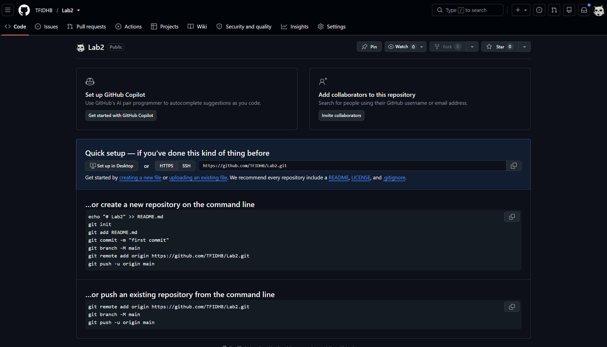
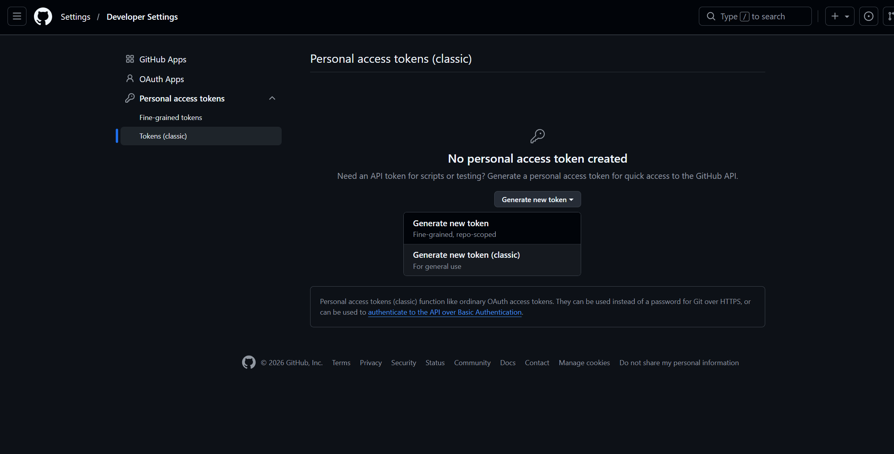
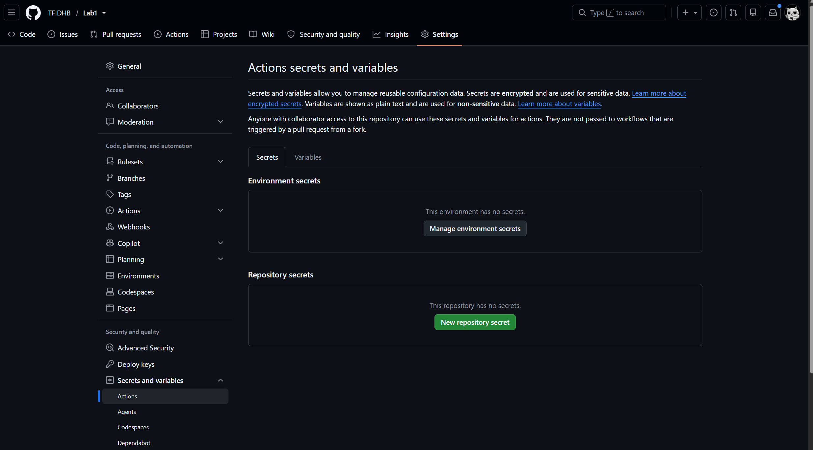
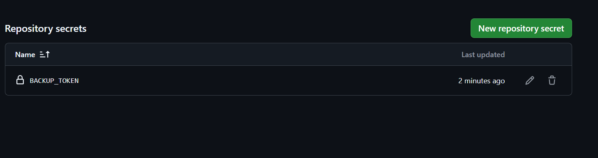
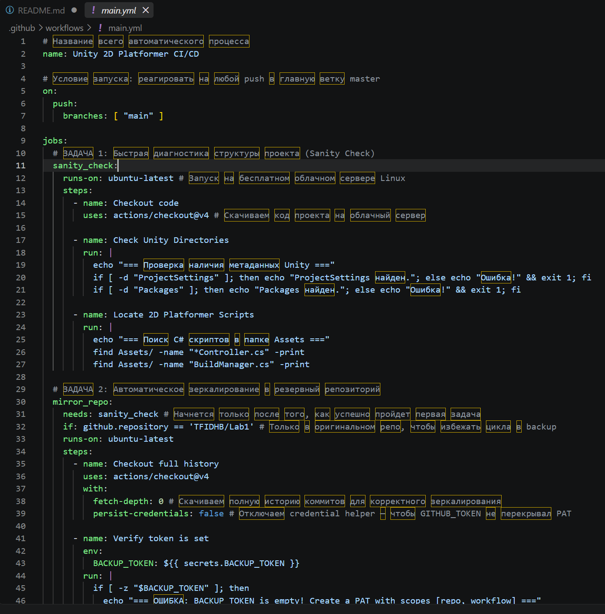
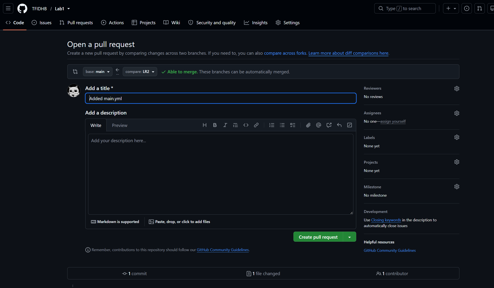
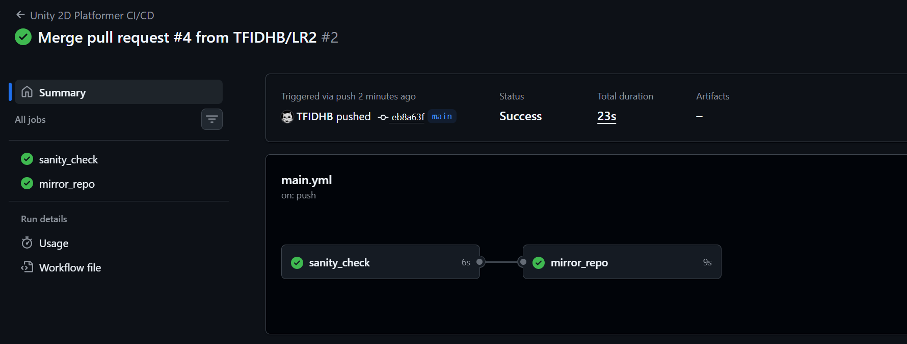
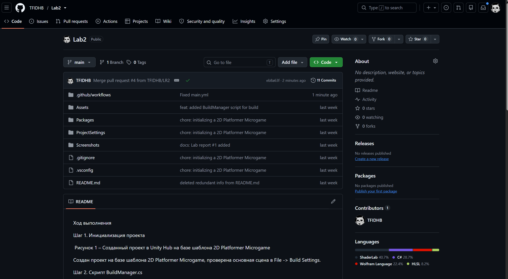

# Лабораторная работа №2. Автоматическое зеркалирование репозитория через GitHub Actions

## Ход выполнения

### Шаг 1. Создание резервного репозитория для зеркалирования

Рисунок 1 – Пустой репозиторий Lab2 на GitHub

Создан второй пустой репозиторий с именем Lab2 без файлов README и .gitignore. Скопирован его URL-адрес для дальнейшего использования в пайплайне.

### Шаг 2. Генерация токена доступа (PAT Token)

Рисунок 2 – Страница Developer settings > Personal access tokens > Tokens (classic)

В настройках аккаунта GitHub (Settings > Developer settings > Personal access tokens > Tokens (classic)) создан новый токен классического типа с названием Backup-Token. Установлены права доступа repo и workflow. Сгенерированный токен скопирован и сохранён.

### Шаг 3. Сохранение токена в секреты основного проекта

Рисунок 3 – Страница Settings > Secrets and variables > Actions основного репозитория

В настройках основного репозитория игры-платформера во вкладке Secrets and variables > Actions добавлен новый секрет репозитория. В поле Name указано BACKUP_TOKEN (заглавными буквами), в поле Value вставлен скопированный на Шаге 2 токен. Нажата кнопка Add secret.

Рисунок 4 – Созданный секрет

### Шаг 4. Написание единого YAML пайплайна

Рисунок 5 – Файл .github/workflows/main.yml в окне редактора кода

В корне проекта создана структура папок .github/workflows/. Внутри папки workflows создан файл main.yml, содержащий два job:

- sanity_check – проверка наличия метаданных Unity (папки ProjectSettings и Packages) и поиск C# скриптов контроллера и менеджера сборки;
- mirror_repo – автоматическое зеркалирование кода в резервный репозиторий с использованием сохранённого токена BACKUP_TOKEN.

### Шаг 5. Отправка пайплайна на GitHub

Рисунок 6 – Pull Request ветки LR2 в репозитории на GitHub

Файл main.yml сохранён, создана новая ветка LR2. Аналогично ЛР №1 создан Pull Request, изменения отправлены в GitHub. Нажата кнопка Merge pull request, код ветки LR2 объединён с веткой main.

### Шаг 6. Проверка результатов

Рисунок 7 – Вкладка Actions основного репозитория с двумя зелёными галочками sanity_check и mirror_repo

На вкладке Actions основного репозитория запущен рабочий процесс «Unity 2D Platformer CI/CD». Обе задачи — sanity_check и mirror_repo – выполнены успешно (отображаются зелёные галочки).

Рисунок 8 – Содержимое резервного репозитория Lab2 после зеркалирования

Резервный репозиторий Lab2, ранее пустой, теперь содержит полный код проекта, структуру папок и историю коммитов – GitHub Actions автоматически скопировал всё содержимое.
