# Лабораторная работа №3. Контейнеризация веб-сервера в Docker и раздача сжатых файлов со стороны Nginx

## Ход выполнения

### Шаг 1. Включение Gzip-сжатия в Unity 6 и пересборка

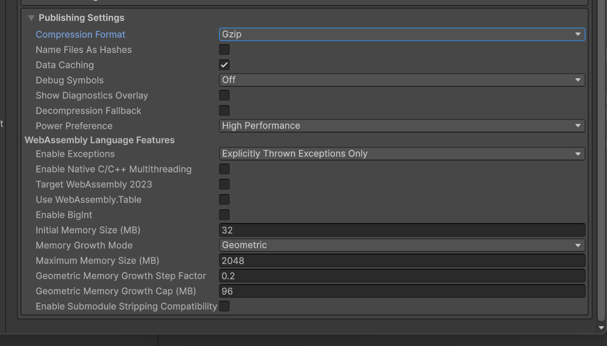
Рисунок 1 – Player Settings -> Publishing Settings: Compression Format = Gzip, Decompression Fallback отключён

Проект пересобран через терминал командой из ЛР №1:

```powershell
& "C:\Program Files\Unity\Hub\Editor\<версия>\Editor\Unity.exe" -batchmode -nographics -executeMethod BuildManager.BuildWebGL -quit -logFile build_webgl.log
```

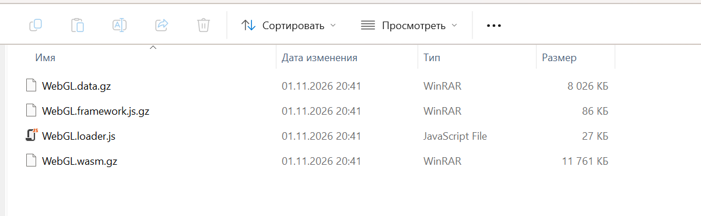
Рисунок 2 – Содержимое папки Builds/WebGL/Build/ с файлами .js.gz, .wasm.gz и .data.gz

В папке `Builds/WebGL/Build/` файлы получили расширения `.js.gz`, `.wasm.gz` и `.data.gz`.

### Шаг 2. Конфигурация веб-сервера nginx.conf

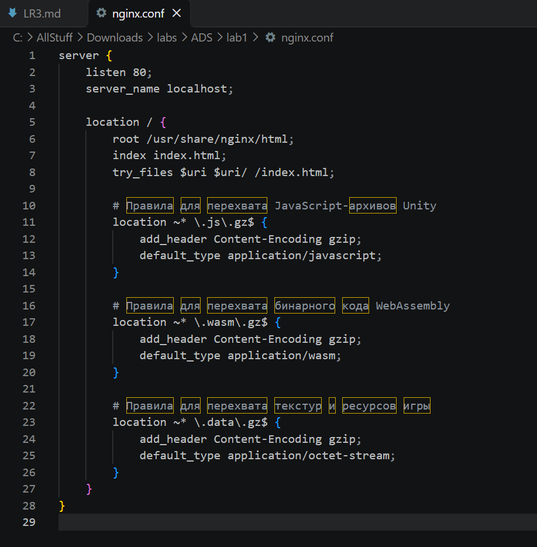
Рисунок 3 – Файл nginx.conf в VS Code

В корне проекта создан файл `nginx.conf`. Для `.js.gz`, `.wasm.gz` и `.data.gz` он добавляет заголовок `Content-Encoding: gzip` и задаёт корректный тип содержимого.

### Шаг 3. Создание Dockerfile

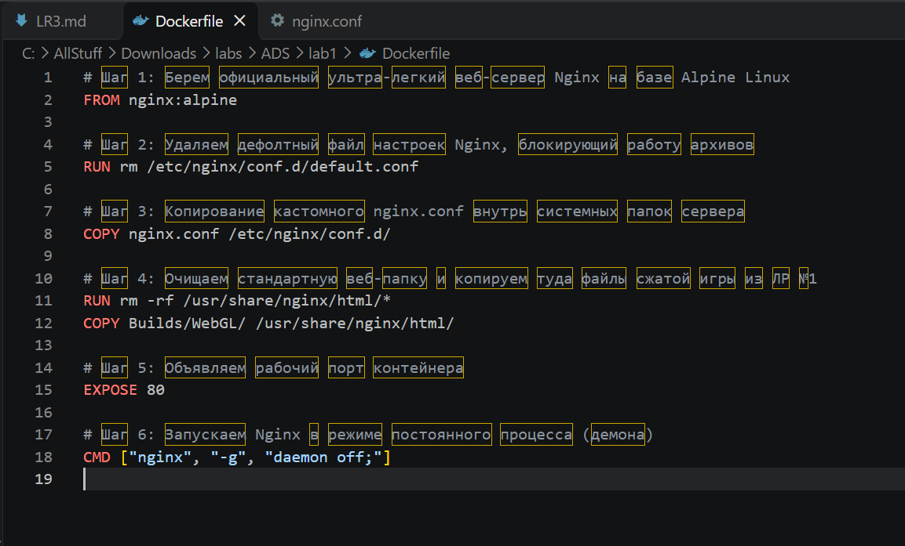
Рисунок 4 – Файл Dockerfile в VS Code

В корне проекта создан файл `Dockerfile` (без расширения). Он берёт лёгкий образ `nginx:alpine`, удаляет стандартную конфигурацию, подставляет собственный `nginx.conf` и копирует в веб-папку Nginx сжатую сборку игры:


### Шаг 4. Локальное тестирование контейнера

Сборка образа:

```bash
docker build -t platformer-compressed:v1 .
```

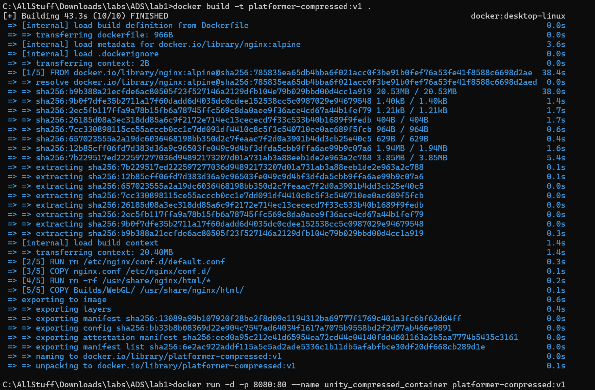
Рисунок 5 – Успешная сборка Docker-образа

Запуск контейнера в фоновом режиме с пробросом порта 8080:

```bash
docker run -d -p 8080:80 --name unity_compressed_container platformer-compressed:v1
```

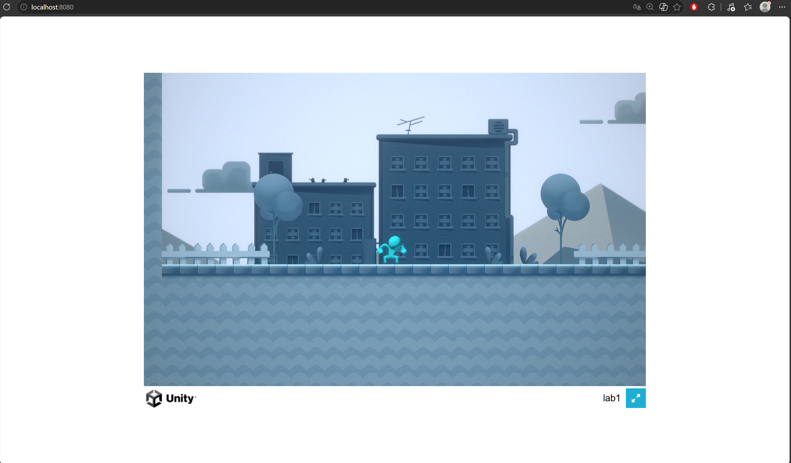
Рисунок 6 – Игра, запущенная из контейнера по адресу http://localhost:8080

Игра успешно загрузилась по адресу `http://localhost:8080`.

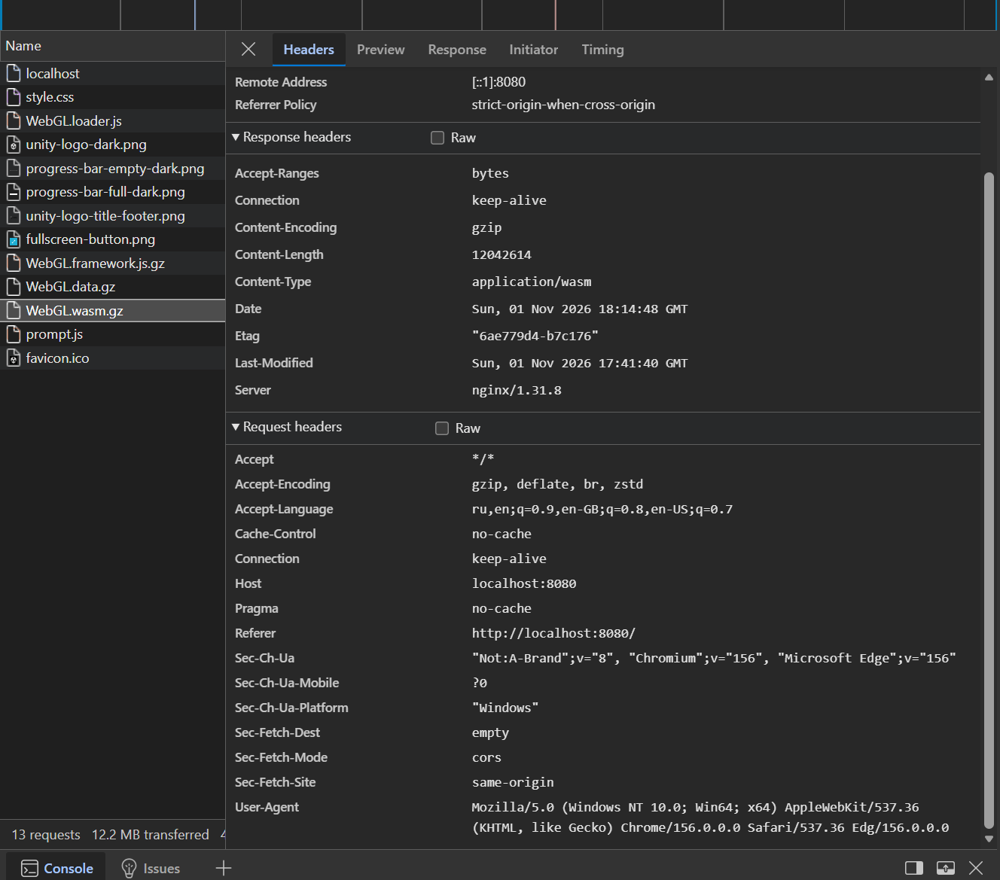
Рисунок 7 – DevTools -> Network: у файла .wasm.gz присутствует заголовок Content-Encoding: gzip

В DevTools (F12 -> Network) после перезагрузки страницы (Ctrl + F5) у файла `.wasm.gz` во вкладке Headers присутствует строка `Content-Encoding: gzip`.

Тестовый контейнер остановлен и удалён:

```bash
docker stop unity_compressed_container && docker rm unity_compressed_container
```

### Шаг 5. Третий этап пайплайна в GitHub Actions

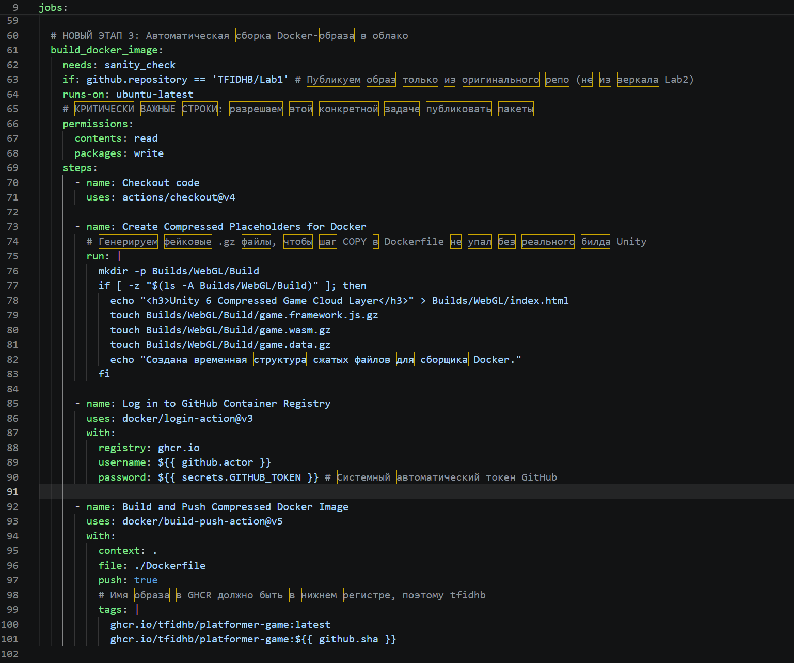
Рисунок 8 – Задача build_docker_image в файле .github/workflows/main.yml

### Шаг 6. Отправка изменений на GitHub

Аналогично ЛР №1 и ЛР №2 изменения отправлены через отдельную ветку и Pull Request:

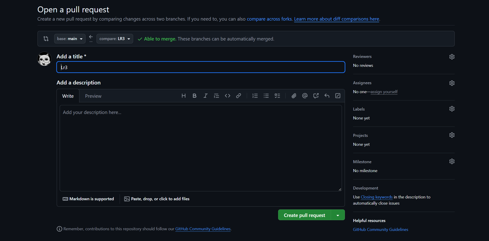
Рисунок 9 – Pull Request ветки LR3 и файлы Dockerfile, nginx.conf, main.yml в репозитории на GitHub

### Шаг 7. Проверка результатов

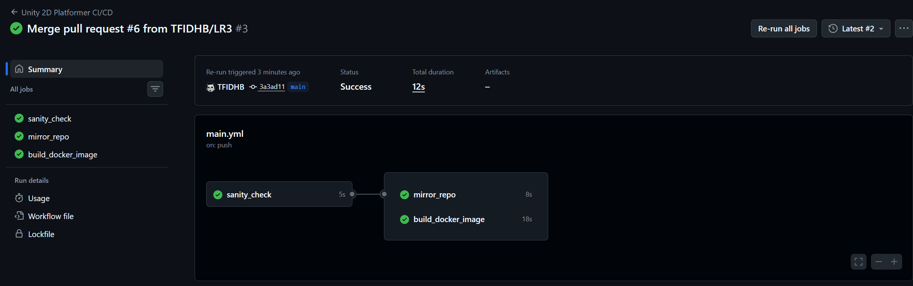
Рисунок 10 – Вкладка Actions: все три задачи завершились со статусом Passed

Во вкладке Actions все три задачи (`sanity_check`, `mirror_repo`, `build_docker_image`) выполнены успешно.

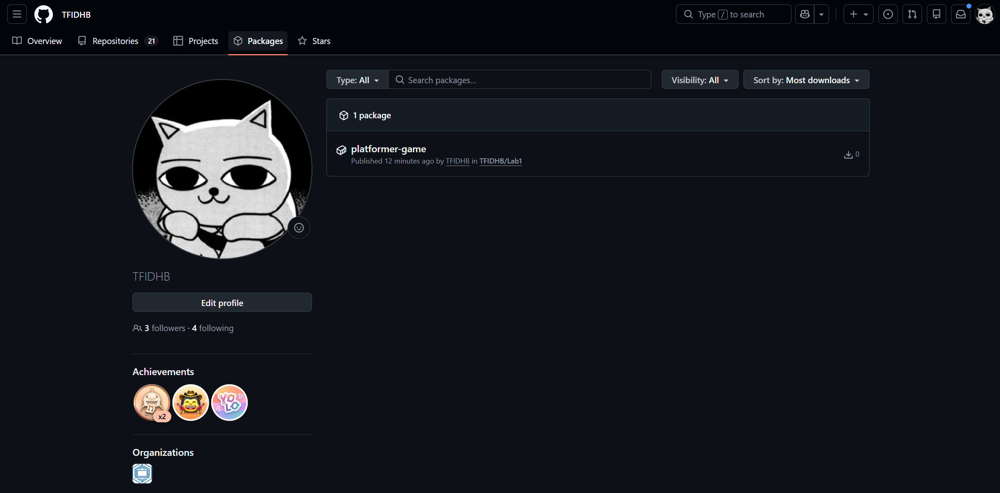
Рисунок 11 – Пакет platformer-game во вкладке Packages профиля GitHub с тегами latest и sha коммита

Во вкладке Packages профиля появился пакет `platformer-game` с тегами `latest` и хешем коммита – это и есть переносимый образ (веб-сервер Nginx и сжатая игра внутри).
