# Лабораторная работа №4. Автоматизация тестирования (Unity Test Runner) в CI/CD

**Индивидуальный вариант: 15** – механика PlayerEnteredDeathZone (PlayMode): вход игрока в DeathZone планирует событие PlayerEnteredDeathZone.

## Ход выполнения

### Шаг 1. Разделение кодовой базы (Assembly Definitions)

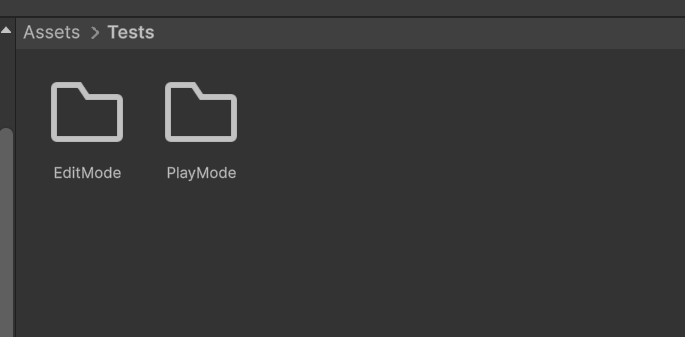
Рисунок 1 – Структура Assets/Scripts/GameAssembly.asmdef и Assets/Tests/EditMode, Assets/Tests/PlayMode в окне Project

EditMode- и PlayMode-тесты размещены в отдельных папках с отдельными `.asmdef`: режим запуска определяется настройкой тестовой сборки (`includePlatforms: ["Editor"]` – только EditMode, без этого параметра – только PlayMode).

### Шаг 2. Базовые автоматические тесты

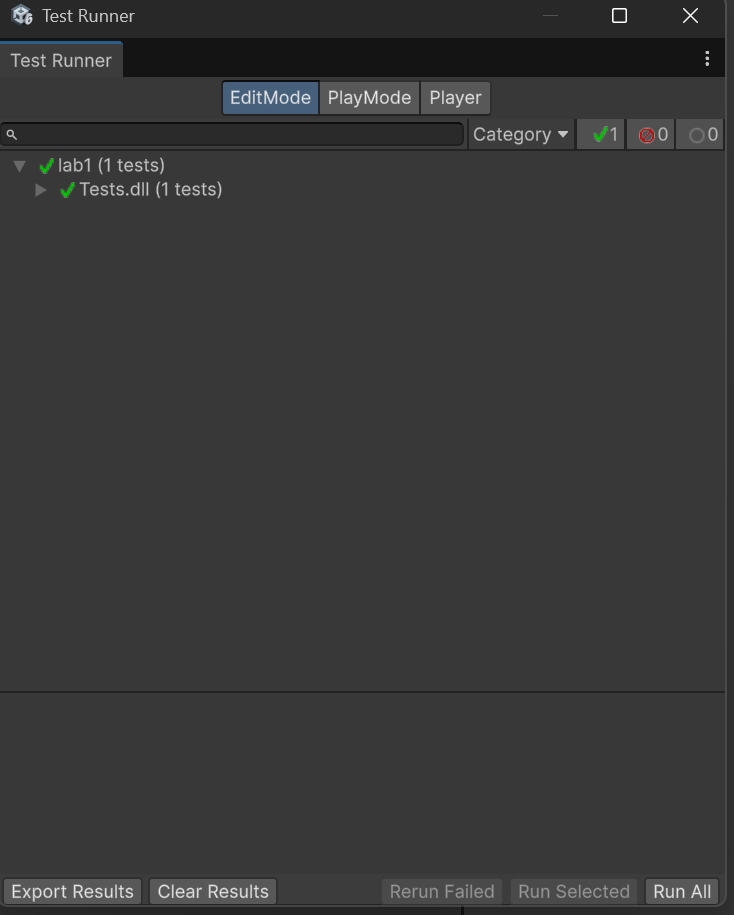
Рисунок 2 – Test Runner, вкладка EditMode: тест EditMode_PlayerTag_IsCorrect пройден

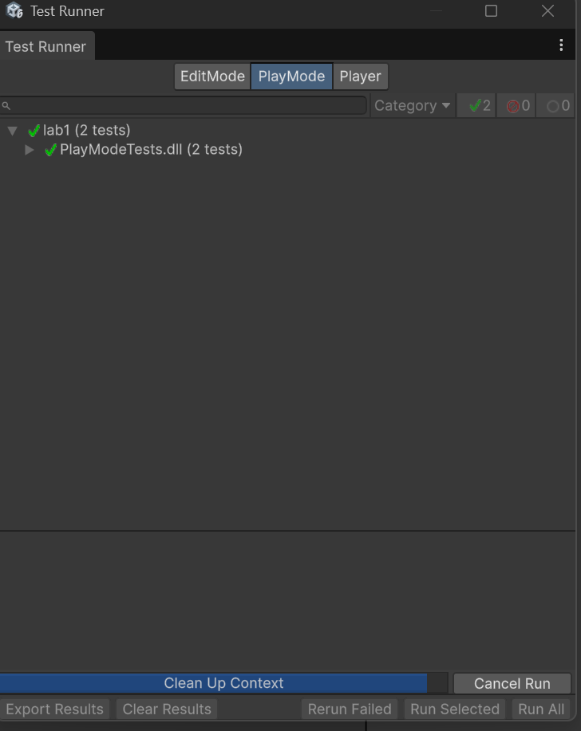
Рисунок 3 – Test Runner, вкладка PlayMode: тест PlayMode_PlayerTakesDamage_HealthDecreases пройден

### Шаг 3. Тест по индивидуальному варианту (вариант 15)

Рисунок 4 – Test Runner, вкладка PlayMode: тест PlayMode_PlayerEntersDeathZone_SchedulesPlayerEnteredDeathZone пройден

**Проверяемый сценарий.** Компонент `DeathZone` при входе в триггер объекта с компонентом `PlayerController` планирует в симуляции (`Simulation`) событие `PlayerEnteredDeathZone`.
**Результат теста по варианту:** тест `PlayMode_PlayerEntersDeathZone_SchedulesPlayerEnteredDeathZone` пройден (зелёный).

### Шаг 4. Настройка запуска тестов в GitHub Actions

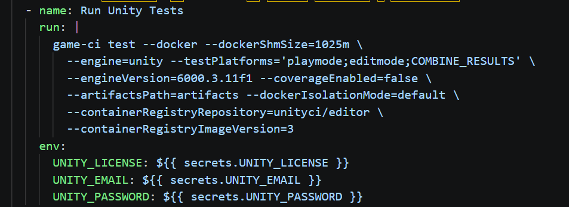
Рисунок 5 – Задача run_tests в файле .github/workflows/main.yml

В `.github/workflows/main.yml` добавлена задача `run_tests` (после `sanity_check`).

Задачи `mirror_repo` и `build_docker_image` теперь начинаются с `needs: run_tests`: при падении любого теста сборка Docker-образа и зеркалирование не запускаются.

### Шаг 5. Добавление лицензии Unity в секреты

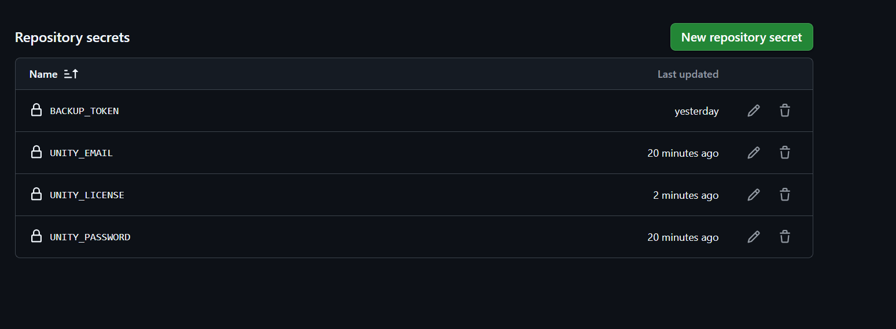
Рисунок 6 – Settings -> Secrets and variables -> Actions: секреты UNITY_LICENSE, UNITY_EMAIL, UNITY_PASSWORD

В Unity Hub активирована личная (Personal) лицензия, в Settings -> Secrets and variables -> Actions репозитория созданы секреты.

### Шаг 6. Отправка изменений на GitHub

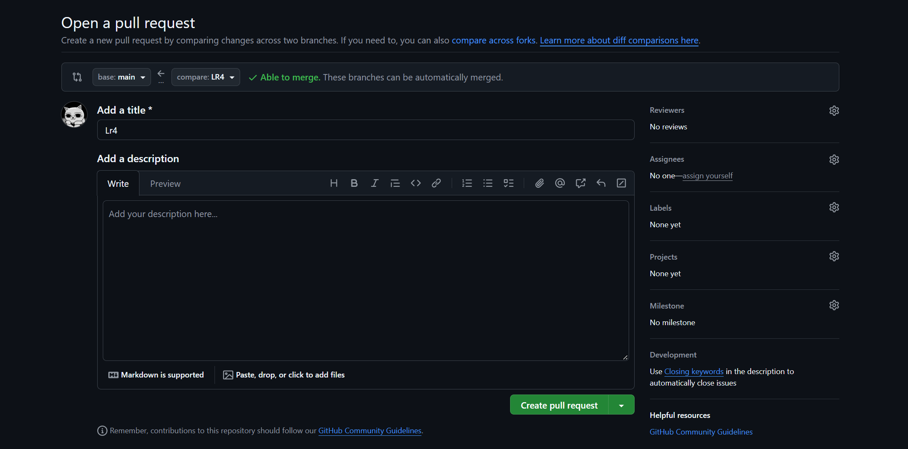
Рисунок 7 – Pull Request ветки LR4 в репозитории на GitHub

На GitHub создан Pull Request ветки LR4 и нажата кнопка Merge pull request – код объединён с веткой main, после чего запустился пайплайн.

### Шаг 7. Проверка результатов

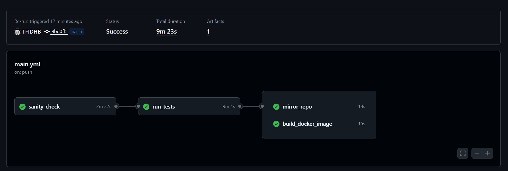
Рисунок 8 – Вкладка Actions: все задачи завершились успешно

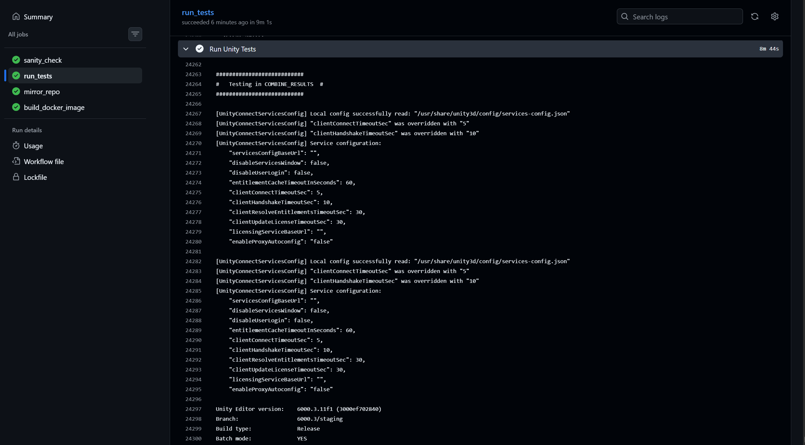
Рисунок 9 – Лог задачи run_tests с результатами тестов EditMode и PlayMode

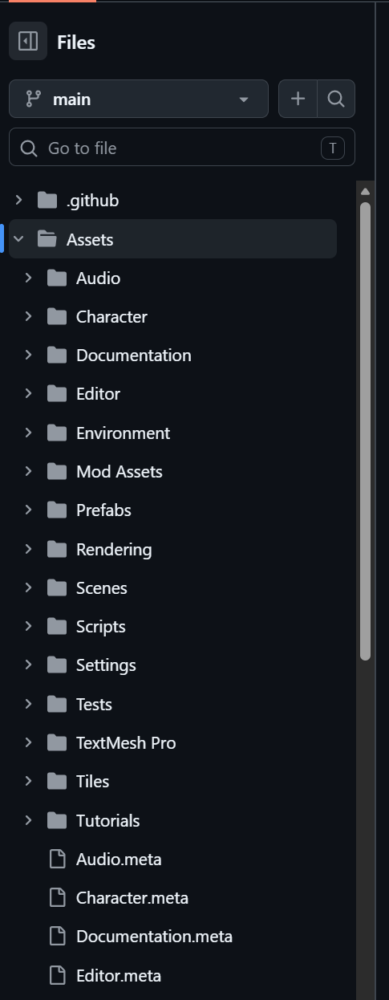
Рисунок 10 – Папка Assets/Tests с тестами и .asmdef-файлами в репозитории GitHub

Во вкладке Actions зелёными прошли `sanity_check`, `run_tests`, `mirror_repo` и `build_docker_image`. Результаты тестов сохранены в артефакте `test-results`. Папка `Assets/Tests` с тестами и `.asmdef` присутствует в репозитории.

### Шаг 8. Демонстрация защиты пайплайна

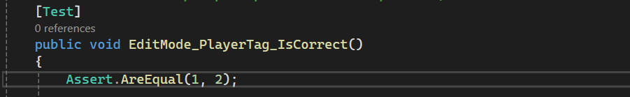
Рисунок 11 – Тест с намеренной ошибкой Assert.AreEqual(1, 2)

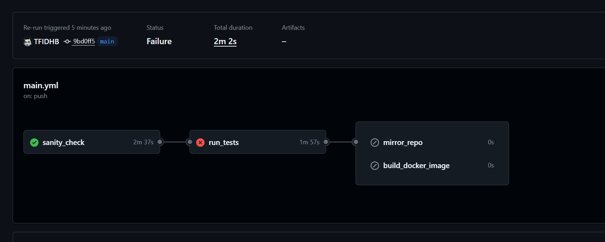
Рисунок 12 – Задачи mirror_repo и build_docker_image не запущены (пропущены)

В тесте временно написано `Assert.AreEqual(1, 2)`, изменения отправлены в `main`. Задача `run_tests` завершилась ошибкой, а `mirror_repo` и `build_docker_image` не запустились: сломанный коммит заблокирован и не дошёл до зеркалирования и публикации образа. После этого логика теста возвращена к исправленному варианту.
