# Лабораторная работа №5. Автоматическая компиляция WebGL-игры в облаке и деплой на GitHub Pages

## Ход выполнения

### Шаг 1. Подготовка Unity 6 к деплою на GitHub Pages

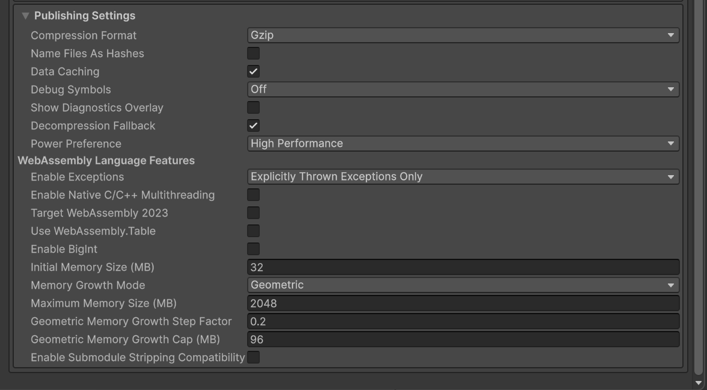
Рисунок 1 – Player Settings -> WebGL -> Publishing Settings: Compression Format = Gzip, Decompression Fallback включён

GitHub Pages не отправляет заголовок `Content-Encoding: gzip` для предсжатых файлов, поэтому в Publishing Settings оставлен формат сжатия Gzip и включена галочка Decompression Fallback (в ЛР №3 она была отключена). Unity внедряет в билд JS-распаковщик, который распаковывает `.gz` на стороне клиента.

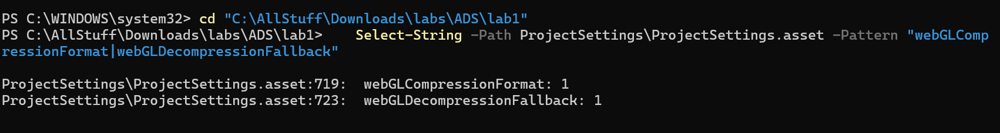
Рисунок 2 – Результат проверки параметров в ProjectSettings.asset

Получено `webGLCompressionFormat: 1` (Gzip) и `webGLDecompressionFallback: 1`. Изменения в `ProjectSettings.asset` закоммичены.

### Шаг 2. Модернизация облачного пайплайна

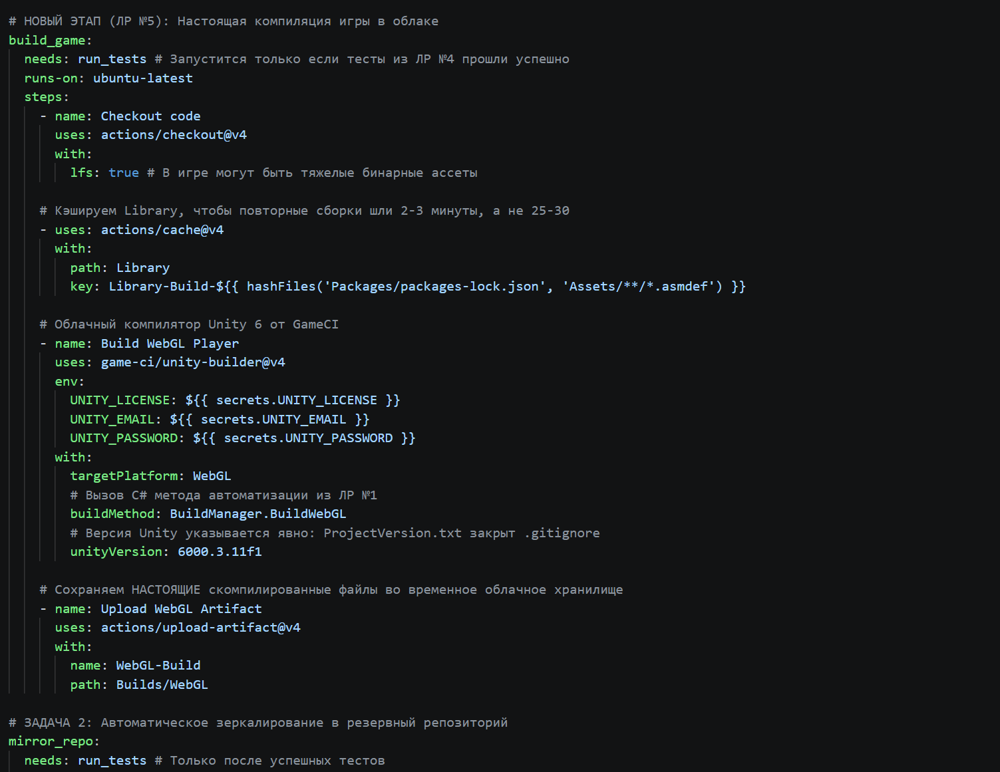
Рисунок 3 – Файл .github/workflows/main.yml с новыми задачами build_game и deploy_to_pages

В `.github/workflows/main.yml` внесены изменения:

- добавлена задача `build_game` (`needs: run_tests`): кэширует папку `Library`, компилирует игру через `game-ci/unity-builder@v4` с `buildMethod: BuildManager.BuildWebGL` и `unityVersion: 6000.3.11f1`, затем загружает папку `Builds/WebGL` в артефакт `WebGL-Build`;
- в задаче `build_docker_image` шаг генерации заглушек (`touch`) заменён на `actions/download-artifact@v4`, зависимость изменена на `needs: build_game`;
- добавлена задача `deploy_to_pages` (`needs: build_game`, `permissions: contents: write`): скачивает артефакт `WebGL-Build` и публикует его в ветку `gh-pages` через `JamesIves/github-pages-deploy-action@v4`;
- задачи `sanity_check`, `run_tests` и `mirror_repo` оставлены без изменений.

### Шаг 3. Отправка изменений на GitHub

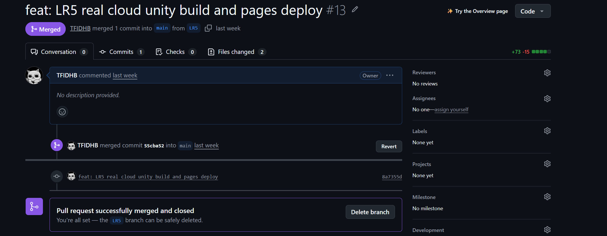
Рисунок 4 – Pull Request ветки LR5 в репозитории на GitHub

Аналогично предыдущим работам изменения отправлены через отдельную ветку LR5 и Pull Request, после Merge pull request код попал в `main` и запустил пайплайн.

### Шаг 4. Включение GitHub Pages в настройках репозитория

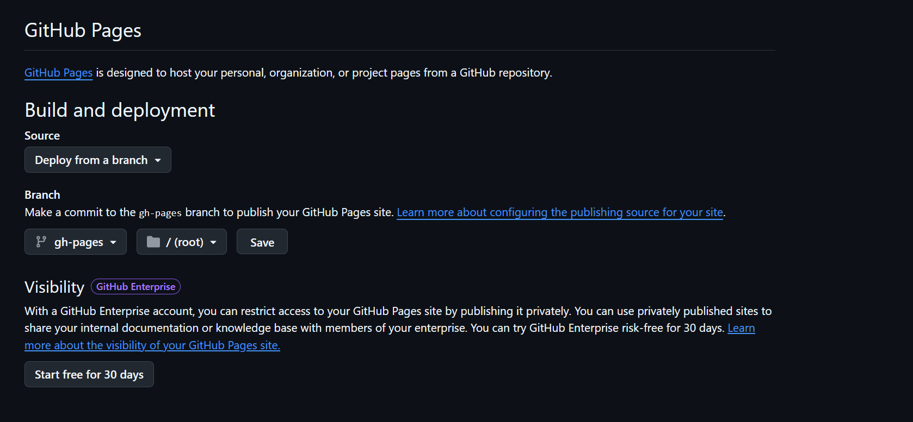
Рисунок 5 – Settings -> Pages: Source = Deploy from a branch, Branch = gh-pages, Folder = / (root)

Задача `deploy_to_pages` только публикует билд в ветку `gh-pages`, но не включает сам хостинг. В Settings -> Pages выбраны Source: Deploy from a branch, Branch: `gh-pages`, Folder: `/ (root)`, нажата кнопка Save. Через 1-2 минуты появилась ссылка на сайт: https://tfidhb.github.io/Lab1/

### Шаг 5. Проверка результатов

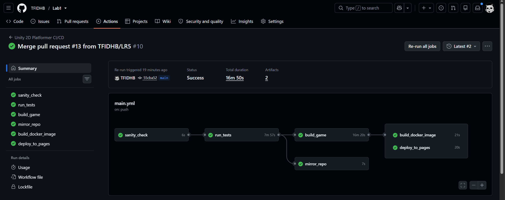
Рисунок 6 – Вкладка Actions: все задачи завершились успешно, build_game запущен после run_tests

Во вкладке Actions все задачи (`sanity_check`, `run_tests`, `build_game`, `mirror_repo`, `build_docker_image`, `deploy_to_pages`) выполнены успешно.

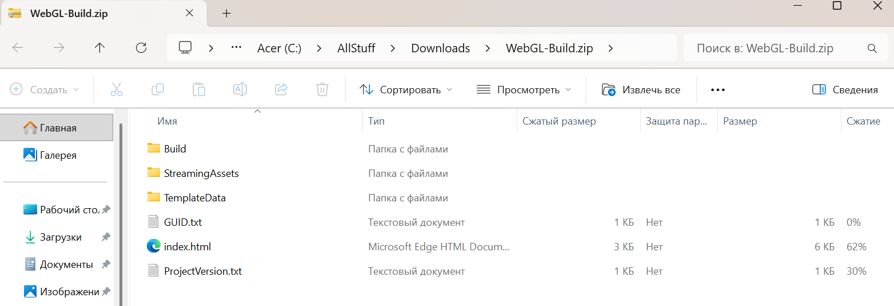
Рисунок 8 – Артефакт WebGL-Build и его содержимое

Артефакт `WebGL-Build` скачан: внутри настоящие файлы `index.html`, `Build/*.js.gz`, `Build/*.wasm.gz`, `Build/*.data.gz`, а не пустые заглушки.

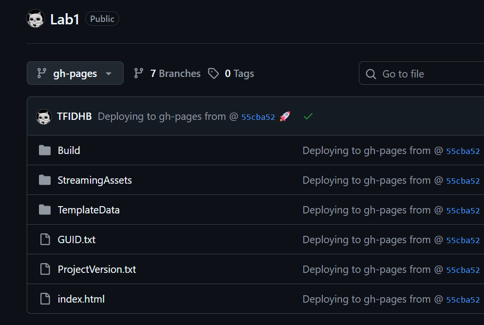
Рисунок 9 – Ветка gh-pages в репозитории

В ветке `gh-pages` находятся `index.html` и папки `Build`, `StreamingAssets`, `TemplateData`.

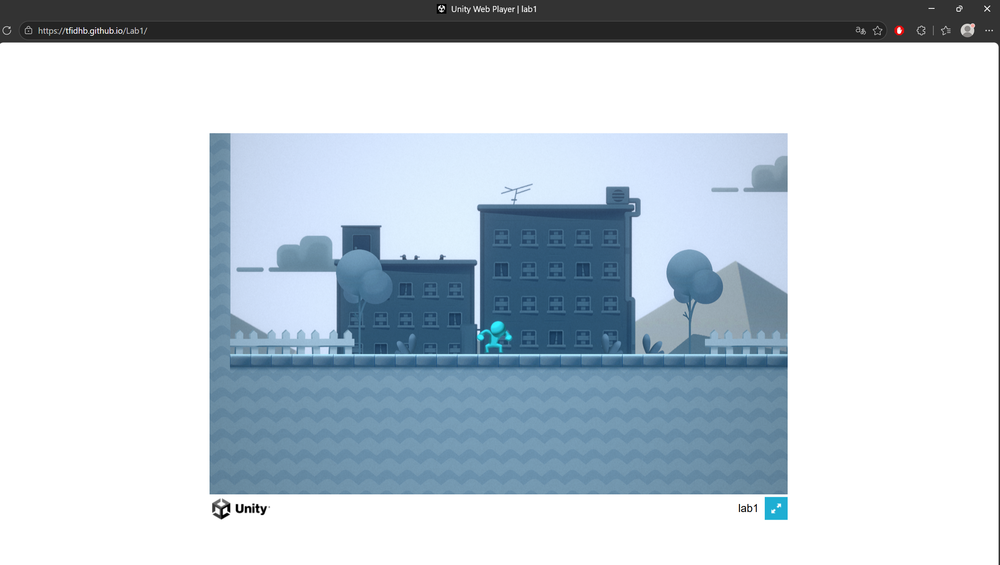
Рисунок 10 – Игра, запущенная на GitHub Pages

По ссылке https://tfidhb.github.io/Lab1/ игра загружается: отображается полоса загрузки Unity, персонаж управляется, работают прыжки и сбор монет.

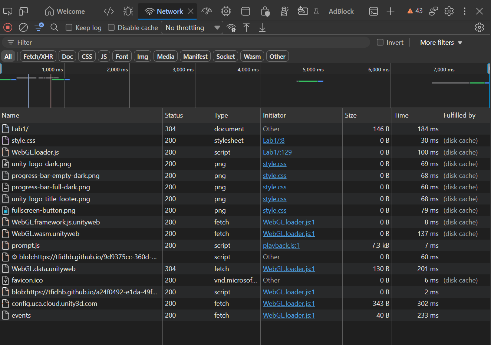
Рисунок 11 – DevTools -> Network и Console на странице игры

В DevTools (F12 -> Network) файлы `index.html`, `Build/*.js.gz`, `*.wasm.gz`, `*.data.gz` загружаются с кодом 200, в Console нет ошибок распаковки – это подтверждает работу Decompression Fallback.

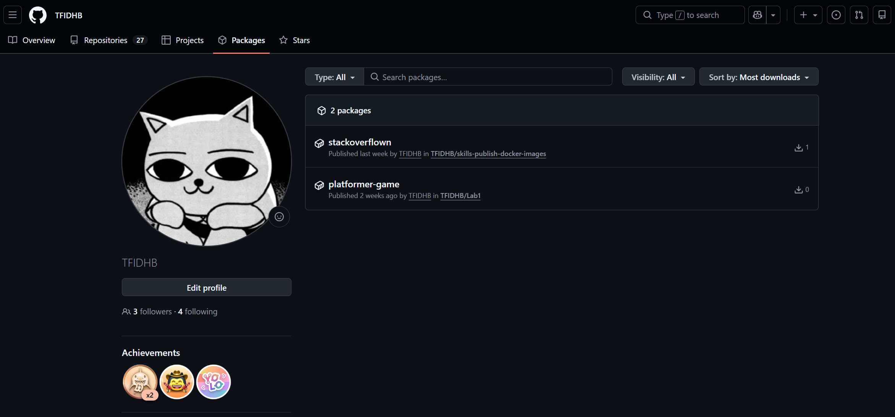
Рисунок 12 – Пакет platformer-game во вкладке Packages профиля GitHub

Во вкладке Packages профиля появился пакет `platformer-game` с тегами `latest` и хешем последнего коммита. Образ запущен локально:

```bash
docker run -d -p 8080:80 ghcr.io/tfidhb/platformer-game:latest
curl -I -H "Accept-Encoding: gzip" http://localhost:8080/Build/<файл>.js.gz
```

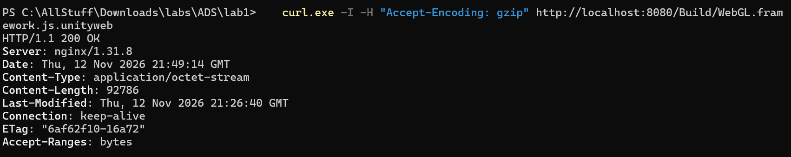
Рисунок 13 – Ответ curl с заголовком Content-Encoding: gzip

В ответе `curl` присутствует заголовок `Content-Encoding: gzip`, игра по адресу `http://localhost:8080` работает.

