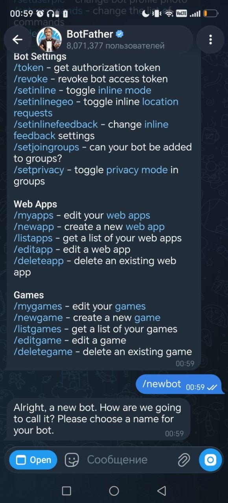
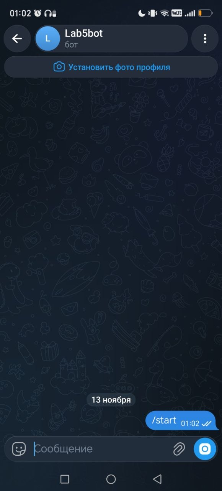
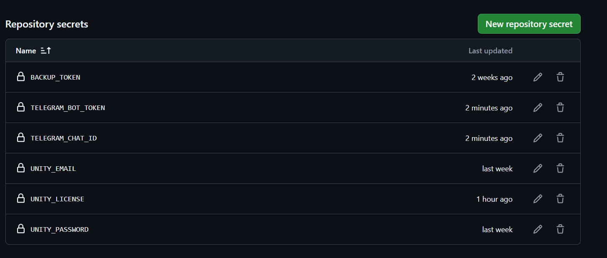
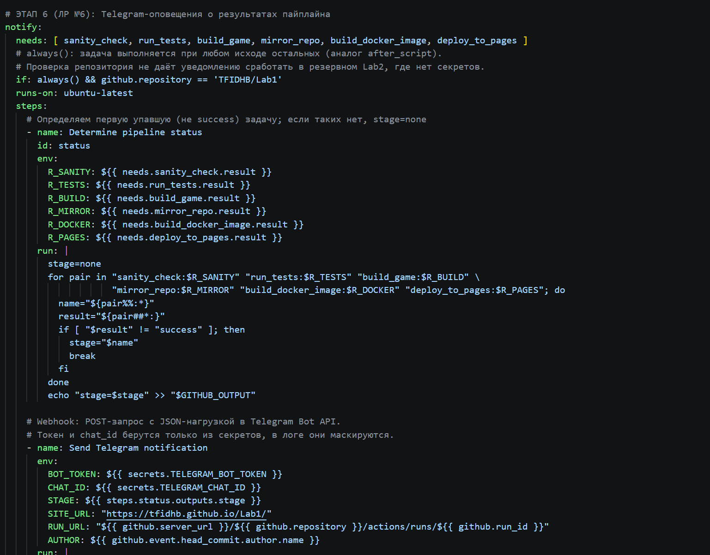
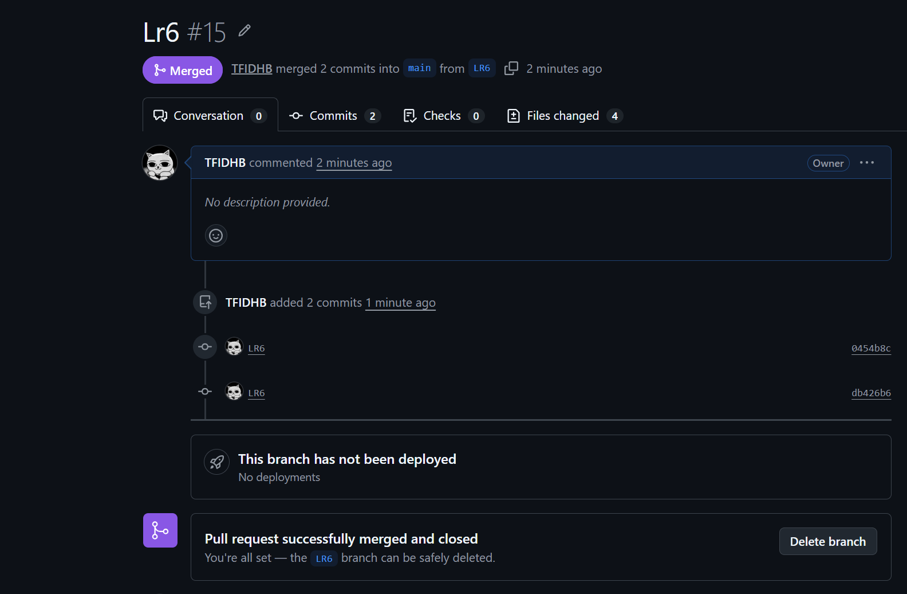
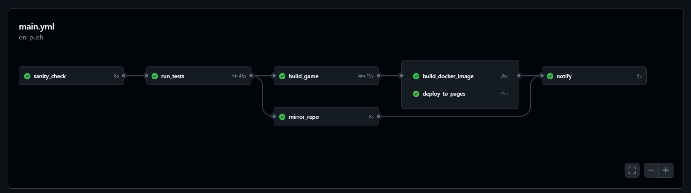
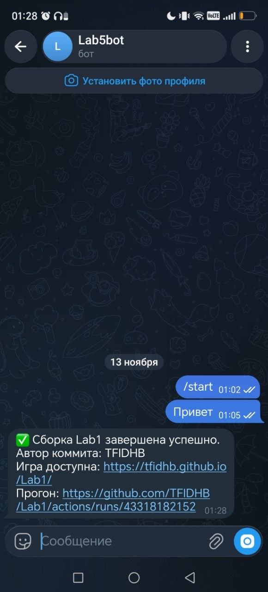
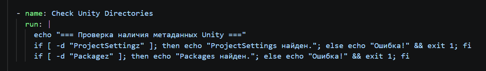
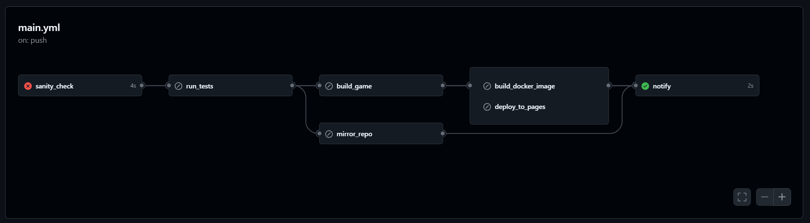
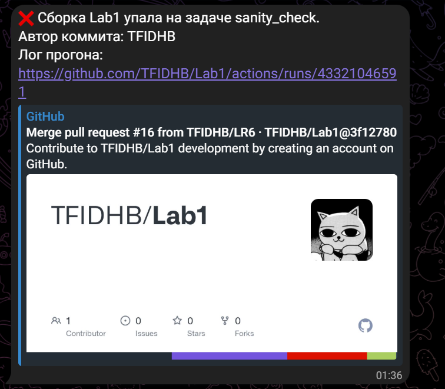

# Лабораторная работа №6. Мониторинг пайплайна, Webhooks и Telegram-оповещения

## Ход выполнения

### Шаг 1. Создание Telegram-бота и получение параметров доступа


Рисунок 1 – Создание бота в диалоге с @BotFather (команда /newbot)

В Telegram найден официальный бот @BotFather, командой `/newbot` заданы имя и username бота (оканчивается на `bot`), получен токен.


Рисунок 2 – Личный чат с ботом, отправлена команда /start

Создан личный чат с ботом и отправлена команда `/start`: бот не может написать первым, без этого сообщения не придут.

Токен проверен, а идентификатор чата получен запросом:

```bash
curl -s "https://api.telegram.org/bot<TOKEN>/getUpdates"
```

В массиве `result` найдено поле `chat.id` – это `CHAT_ID` личного чата с ботом.

### Шаг 2. Добавление секретов в репозиторий


Рисунок 4 – Settings -> Secrets and variables -> Actions: секреты TELEGRAM_BOT_TOKEN и TELEGRAM_CHAT_ID

В настройках репозитория созданы два секрета: `TELEGRAM_BOT_TOKEN` (токен бота) и `TELEGRAM_CHAT_ID` (значение `chat.id`). Токен и `chat_id` не встречаются ни в `main.yml`, ни в других файлах проекта.

### Шаг 3. Добавление задачи уведомления в пайплайн


Рисунок 5 – Задача notify в файле .github/workflows/main.yml

В `.github/workflows/main.yml` добавлена задача `notify`:

- `needs` содержит все остальные задачи пайплайна (`sanity_check`, `run_tests`, `build_game`, `mirror_repo`, `build_docker_image`, `deploy_to_pages`);
- условие `if: always() && github.repository == 'TFIDHB/Lab1'`: `always()` запускает задачу при любом исходе остальных, а проверка репозитория исключает срабатывание в резервном репозитории Lab2, где нет секретов;
- шаг `Determine pipeline status` читает `${{ needs.<задача>.result }}` и находит первую задачу со статусом, отличным от `success` (если таких нет, результат `none`);
- шаг `Send Telegram notification` формирует JSON с помощью `jq` (корректно экранирует кавычки и переводы строк) и отправляет его POST-запросом методом `sendMessage` через `curl`. Токен и `chat_id` берутся только из секретов.

Сообщение содержит результат сборки, имя автора коммита, ссылку на игру (при успехе) или ссылку на лог прогона и имя упавшей задачи (при ошибке).

### Шаг 4. Отправка изменений на GitHub


Рисунок 6 – Pull Request ветки LR6 в репозитории на GitHub

Аналогично предыдущим работам изменения отправлены через ветку LR6 и Pull Request; после Merge pull request код попал в `main` и запустил пайплайн.

### Шаг 5. Проверка успешного сценария


Рисунок 7 – Вкладка Actions: все задачи, включая notify, завершились успешно


Рисунок 8 – Сообщение об успешной сборке в Telegram (на телефоне)

После зелёного прогона бот прислал сообщение со ссылкой на игру, именем автора коммита и ссылкой на прогон. Сообщение пришло на мобильный телефон.

### Шаг 6. Проверка аварийного сценария


Рисунок 10 – Намеренная ошибка в шаге Check Unity Directories

В шаге `Check Unity Directories` временно указано несуществующее имя папки, изменение отправлено в `main`.


Рисунок 11 – Вкладка Actions: sanity_check красный, остальные задачи пропущены, notify зелёный

Задача `sanity_check` завершилась ошибкой, зависящие от неё задачи были пропущены, а `notify` всё равно запустилась благодаря `if: always()` и осталась зелёной (отправка выполнена).


Рисунок 12 – Сообщение об ошибке в Telegram с именем упавшей задачи

В Telegram пришло сообщение с именем упавшей задачи `sanity_check`, автором коммита и ссылкой на лог прогона. После проверки файл `main.yml` возвращён в рабочее состояние и отправлен в репозиторий.
